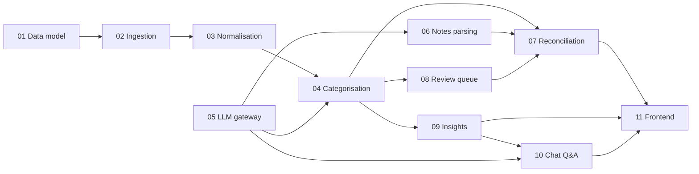

# plan.md: Spend Analyser Master Plan

## 1. Problem
Spending is tracked in Apple Notes (monthly, undated, category-level, inaccurate). Bank truth lives in SBI UPI (GPay) statement PDFs. Existing apps (e.g. CRED Money) mis-categorise and give no way to correct. We want a local tool that ingests both, reconciles them, asks the user about anything unclear, learns from answers, and produces insights.

## 2. Decisions locked in
| Topic | Decision |
|---|---|
| Source of truth | Bank statement. Notes only add context and expose inaccuracy |
| Banks / payment | SBI only, UPI via GPay, no credit cards, no joint accounts |
| History | From June 2025, monthly uploads |
| Statements | Password-protected PDFs |
| Notes | Consistent format, one month's breakdown, no dates, amounts per line |
| Categories | Personal (Rent, Food), Travel, Home Expense, Outing (+ system: Transfer, Income, Uncategorised) |
| Stack | FastAPI, SQLite (SQLAlchemy), React + Vite + Recharts, local machine |
| LLM | Claude, then Gemini Flash, then Groq, then OpenRouter fallback. Redacted data only |
| Interaction | Questions batched in a Review Inbox, no interruptions |

## 3. Principles
1. Bank is truth. 2. Rules before LLM. 3. Human in the loop, every answer becomes a rule. 4. Parse locally, redact before any LLM call. 5. Idempotent ingestion (hash dedupe). 6. Money is `Decimal`, never float. 7. Nothing is silently dropped; failures go to `parse_errors` or the review queue.

## 4. Feature index and dependencies

| # | Feature doc | Depends on |
|---|---|---|
| 01 | [data-model](01-data-model.md) | none |
| 02 | [statement-ingestion](02-statement-ingestion.md) | 01 |
| 03 | [merchant-normalisation](03-merchant-normalisation.md) | 01, 02 |
| 05 | [llm-gateway](05-llm-gateway.md) | none (build early, in parallel) |
| 04 | [categorisation-and-rules](04-categorisation-and-rules.md) | 01, 03, 05 |
| 08 | [review-queue](08-review-queue.md) | 01, 04 |
| 06 | [notes-parsing](06-notes-parsing.md) | 01, 05 |
| 07 | [reconciliation](07-reconciliation.md) | 04, 06, 08 |
| 09 | [insights](09-insights.md) | 04 |
| 10 | [chat-qa](10-chat-qa.md) | 05, 09 |
| 11 | [frontend](11-frontend.md) | all APIs |
| 12 | [testing-and-ops](12-testing-and-ops.md) | all |

## 5. Milestones

| Milestone | Scope | Done when |
|---|---|---|
| M0 Setup | Repo, venv, FastAPI skeleton, Vite app, `.env`, CI lint/test | `GET /health` works, frontend loads |
| M1 Ingestion | 01, 02 | A real SBI PDF becomes clean rows in DB, re-upload creates no duplicates |
| M2 Categorise | 03, 05, 04, 08 | 90%+ of rows categorised after first review session, answers create rules |
| M3 Notes + Reconcile | 06, 07 | Per-month notes vs bank comparison with gap report |
| M4 Insights | 09 + Dashboard | Monthly dashboard, recurring, anomalies, budgets |
| M5 Chat + polish | 10, 11, 12 | Natural-language questions answered from DB, backup/export works |

## 6. Inputs still needed from the user
1. Redacted SBI statement PDF or pasted rows (fixes column layout and narration formats).
2. One month of notes as text.
3. Monthly income and per-category budgets.
4. Optional: GPay Takeout export to improve merchant names.

## 7. Risks and mitigations
| Risk | Mitigation |
|---|---|
| SBI PDF layout varies or changes | Layout detector, golden-file tests, `parse_errors` table |
| Person-to-person UPI payments (rent) cannot be auto-classified | Ask once per payee, store as payee rule |
| Free LLM limits or weaker JSON | Rules and cache first, batching, schema validation, review-queue fallback |
| Notes totals do not map to individual bank rows | Two-pass reconciliation (item match + category totals) |
| Privacy leaks via LLM | Redactor before every call, no balances or account numbers sent |
| Wrong auto-categories silently trusted | Confidence threshold, audit view, easy re-categorise with re-apply |

## 8. Conventions
- Python 3.11+, `ruff` + `black`, type hints everywhere, Pydantic schemas at all boundaries.
- Services are pure where possible: take a `Session` and plain args, return plain objects. Routers stay thin.
- Each feature doc lists: files, function signatures, who calls it, what it calls, tables touched, errors, tasks, acceptance criteria. Update the doc when signatures change.
- Commit per task. Each milestone ends with a tagged commit and a green test run.
