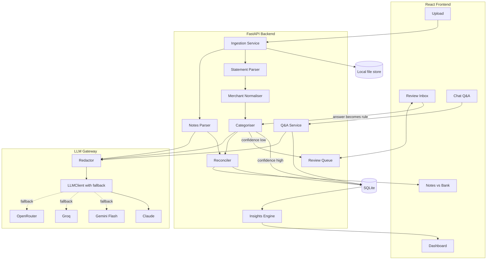
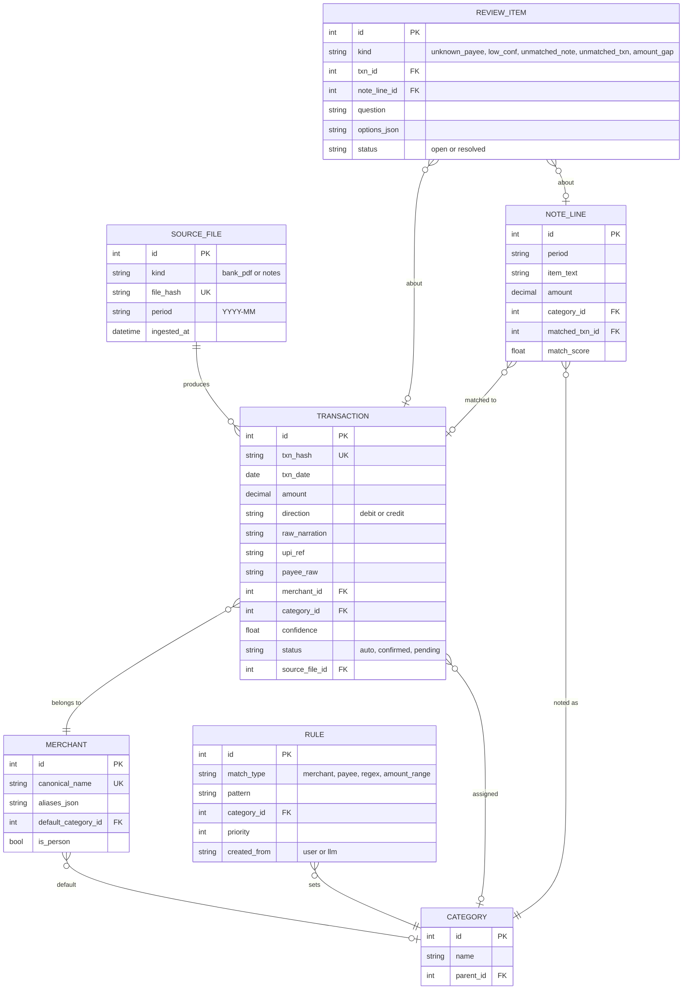
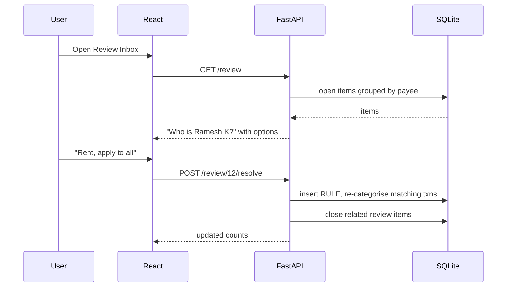

# Personal Spend Analyser: HLD and LLD

**Goal:** ingest SBI UPI statement PDFs and monthly Apple Notes breakdowns, treat the bank as the source of truth, reconcile the two, ask the user about anything unclear, learn from answers, and produce insights.

**Stack:** FastAPI, SQLite (SQLAlchemy), React + Vite + Recharts, local machine. LLM chain: Claude, then Gemini Flash, then Groq, then OpenRouter.

---

# 1. High-Level Design

## 1.1 Architecture



## 1.2 Core principles

1. **Bank is truth.** Notes only add context and are used to detect inaccuracies.
2. **Rules before LLM.** Saved user rules and cached merchant mappings handle most rows. The LLM handles only unknowns.
3. **Human in the loop.** Low confidence goes to the review queue, and every answer becomes a permanent rule.
4. **Privacy.** PDFs are parsed locally. Only redacted merchant strings and amounts reach any LLM.
5. **Idempotent ingestion.** Re-uploading a statement never duplicates rows (hash-based dedupe).

## 1.3 Data flow

1. Upload an SBI PDF (with password) or a monthly notes text file.
2. Parse into raw transactions, then normalise merchants.
3. Categorise: rule match, then cache, then LLM, then review queue.
4. Parse notes into structured lines, then reconcile against bank rows for that month.
5. Surface mismatches and unknown payees in the review inbox.
6. Insights and charts read only from confirmed, categorised data.

## 1.4 Categories

`Personal` (sub: Rent, Food), `Travel`, `Home Expense`, `Outing`, plus system categories `Transfer`, `Income`, `Uncategorised`. Sub-categories are editable.

---

# 2. Low-Level Design

## 2.1 Project structure

```
spend-analyser/
├── backend/
│   ├── app/
│   │   ├── main.py
│   │   ├── config.py              # env, keys, thresholds
│   │   ├── db.py                  # engine, session
│   │   ├── models.py              # SQLAlchemy models
│   │   ├── schemas.py             # Pydantic
│   │   ├── routers/               # upload, transactions, review, insights, chat
│   │   ├── services/
│   │   │   ├── statement_parser.py
│   │   │   ├── upi_narration.py
│   │   │   ├── notes_parser.py
│   │   │   ├── merchant_normaliser.py
│   │   │   ├── categoriser.py
│   │   │   ├── reconciler.py
│   │   │   ├── review_queue.py
│   │   │   ├── insights.py
│   │   │   └── qa.py
│   │   └── llm/
│   │       ├── base.py            # LLMClient interface
│   │       ├── claude.py  gemini.py  groq.py  openrouter.py
│   │       ├── gateway.py         # ordered fallback and retry
│   │       └── redactor.py
│   └── tests/
└── frontend/src/
    ├── pages/ (Dashboard, Review, Compare, Chat, Upload)
    ├── components/ (CategoryChart, TrendChart, TxnTable, ReviewCard)
    └── api.ts
```

## 2.2 Database schema



Indexes: `transaction(txn_date)`, `transaction(category_id)`, `transaction(merchant_id)`, `note_line(period)`.

## 2.3 Module designs

### Statement parser (`statement_parser.py`)

- Unlock with the user-supplied password (`pikepdf`), extract tables with `pdfplumber`.
- Map columns to date, narration, ref/cheque no., debit, credit, balance. The exact layout is confirmed from the sample statement.
- Handle multi-line narrations by merging continuation rows.
- `txn_hash = sha256(date + amount + upi_ref + narration)` for dedupe.
- Output `RawTxn` objects, with debit/credit decided from which column is populated.

### UPI narration parser (`upi_narration.py`)

- Regex-split SBI UPI strings into payee name, UPI handle, ref number, and remark.
- Detect whether the payee is a person (handle like `@ybl`, name-like string with no merchant keyword) or a merchant.
- Flag self-transfers and bill-payment style entries as `Transfer`.

### Merchant normaliser

1. Lowercase, strip digits, location codes and noise tokens.
2. Exact alias lookup, then fuzzy match (`rapidfuzz`, threshold about 90) against known merchants.
3. If no match, create a new merchant as `pending`.

### Categoriser (`categoriser.py`)

```
categorise(txn):
    1. rule match (priority order: payee, merchant, regex, amount range)  -> conf 1.0
    2. merchant.default_category                                         -> conf 0.95
    3. LLM batch classification of unknown merchants                     -> conf from model
    4. if conf >= 0.8: status=auto, else: create REVIEW_ITEM (status=pending)
```

- Person payees (e.g. rent) always trigger a one-time question, then become a `payee` rule.
- The LLM returns strict JSON `[{merchant, category, confidence}]`, validated by Pydantic. Invalid output means one retry, then the review queue.

### Notes parser (`notes_parser.py`)

- Input is a month's text plus the period. One LLM call returns structured lines `{item, amount, category}`.
- If the notes already have your 4 headings, a regex parser is used first and the LLM is only a fallback.
- Validate that line totals are sane, and cache by file hash.

### Reconciler (`reconciler.py`)

Two passes per month:

1. **Item match.** For each note line, score candidate bank debits in the same month: `score = 0.6*amount_match + 0.3*text_similarity(item, merchant) + 0.1*category_agreement`. Amount match is exact, or within about 2% as partial. Greedy one-to-one assignment above a threshold of about 0.7.
2. **Category totals.** Compare noted total and bank total per category. Gaps above a threshold (e.g. 10% or ₹500) create an `amount_gap` review item.

- Unmatched note lines become `unmatched_note`. Unmatched bank debits become `unmatched_txn`.
- The bank category is the truth. When the note category disagrees, the user is asked once, and the answer can become a rule.

### Review queue (`review_queue.py`)

- Batches questions by type (unknown payees first, since one answer fixes many rows).
- An answer can create or update `RULE` rows and re-categorise all matching historical transactions.
- Supports "apply to all past and future", "this one only", and "skip".

### LLM gateway (`llm/gateway.py`)

```python
class LLMClient(Protocol):
    name: str
    def complete_json(self, system: str, user: str, schema: dict) -> dict: ...

class Gateway:
    providers = [Claude(), Gemini(), Groq(), OpenRouter()]  # ordered from config
    def run(self, system, user, schema):
        for p in self.providers:
            try:    return validate(p.complete_json(system, user, schema), schema)
            except (RateLimit, Timeout, InvalidJSON): continue
        raise AllProvidersFailed   # items go to the review queue instead
```

- The redactor runs before every call. It strips account numbers, phone numbers, names where possible, balances and UPI IDs.
- Retries use exponential backoff. Per-provider daily counters avoid hitting limits.

### Insights (`insights.py`)

- Monthly and category totals, month-over-month change, rolling 3-month average.
- Recurring detection: same merchant, similar amount, 25-35 day cadence.
- Anomalies: a transaction above mean + 3 standard deviations for its category.
- Top merchants, weekday and time patterns, savings rate (with income), budget vs actual.
- Notes accuracy score per category: how far your notes drift from the bank.

### Q&A (`qa.py`)

- The LLM turns the question into a structured query spec (filters, group-by, date range), never raw SQL.
- The backend validates the spec, runs it on SQLite, and the LLM narrates only the aggregated result.

## 2.4 REST API

| Method | Endpoint | Purpose |
| --- | --- | --- |
| POST | `/upload/statement` | PDF + password, ingest |
| POST | `/upload/notes` | notes text + period |
| GET | `/transactions` | filters: date, category, merchant, status |
| PATCH | `/transactions/{id}` | change category, optionally create a rule |
| GET | `/review` | open review items, grouped |
| POST | `/review/{id}/resolve` | answer + `apply_scope` |
| GET | `/reconcile/{period}` | note vs bank comparison |
| GET | `/insights/summary` | totals, trends, recurring, anomalies |
| GET/PUT | `/budgets` | budget per category and income |
| POST | `/chat` | natural-language question |

## 2.5 Review resolution sequence



## 2.6 Frontend pages

- **Upload:** drag-drop PDFs and a notes text box per month.
- **Review Inbox:** card per question, one-tap options, bulk "apply to all".
- **Dashboard:** category donut, monthly trend, budget bars, recurring list.
- **Notes vs Bank:** per-category table of noted vs actual with gap highlights and matched/unmatched lists.
- **Chat:** question box with result chart or table.

## 2.7 Config and error handling

- `.env`: provider keys, provider order, confidence threshold (0.8), match threshold (0.7), gap threshold.
- Password-protected PDF failures return a clear error. Unparseable rows are stored in a `parse_errors` table, never silently dropped.
- All amounts are stored as `Decimal` (paise precision), never float.
- Tests: golden-file tests for the parser (redacted sample statements), unit tests for the narration parser, reconciler scoring, and rule application.

---

# 3. Build phases

| Phase | Deliverable |
| --- | --- |
| 1 | DB schema, SBI parser, narration parser, upload API, transaction table |
| 2 | Merchant normaliser, rules, LLM gateway, categoriser, review queue UI |
| 3 | Notes parser, reconciler, Notes vs Bank view |
| 4 | Dashboard and insights, budgets |
| 5 | Chat Q&A |

# 4. Inputs still needed to finalise Phase 1

1. A redacted SBI statement PDF, or a few pasted rows, to fix the exact column layout and narration format.
2. One month of notes as text, to confirm the notes format.
3. Monthly income and per-category budgets.